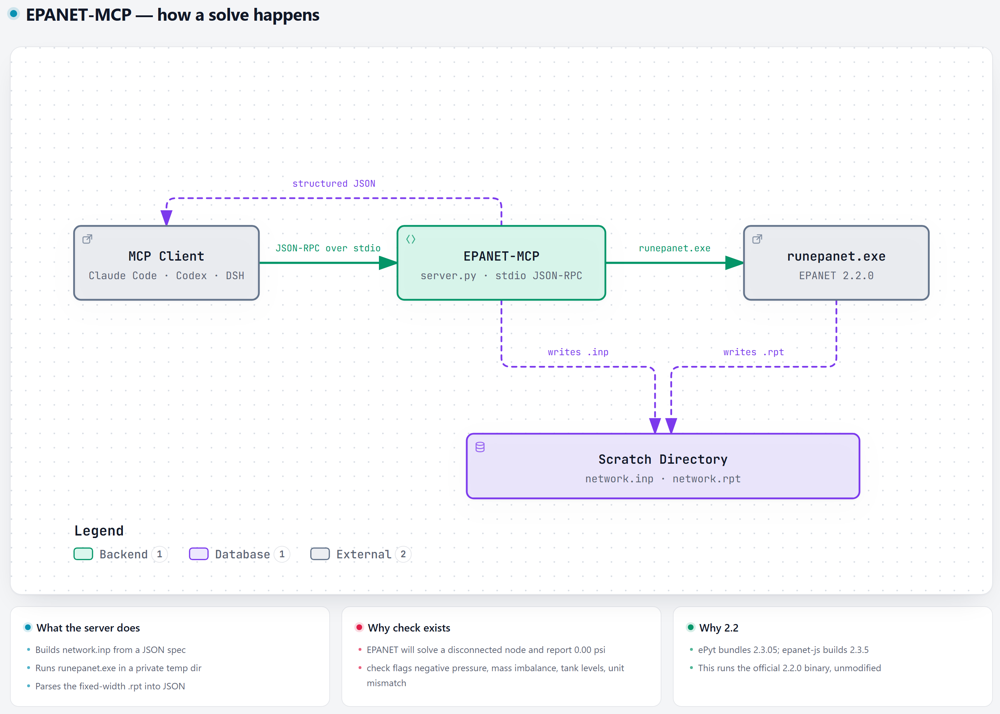
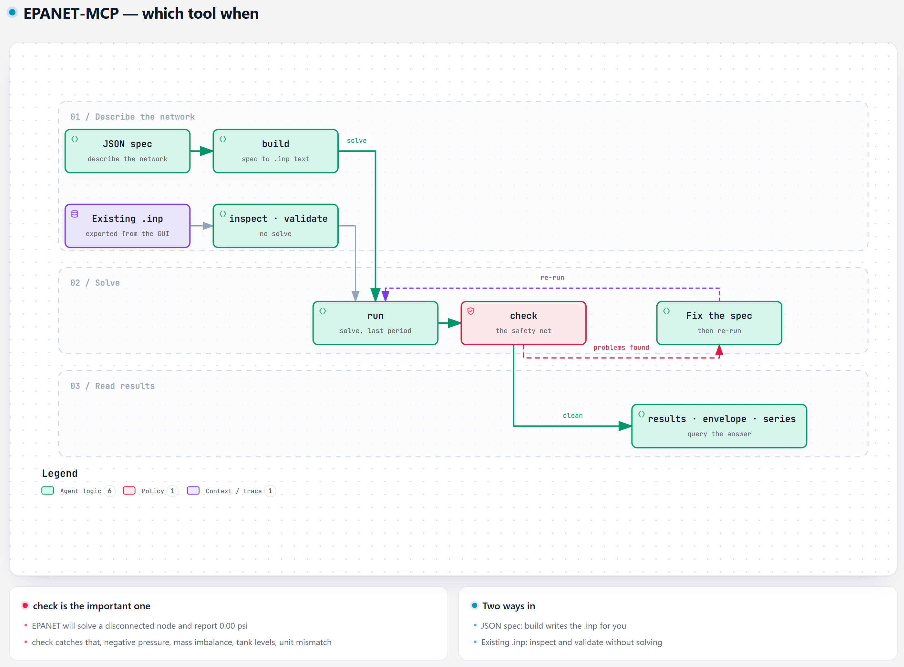

<div align="center">

# 💧 EPANET 2.2 MCP Server

**Run EPA's own EPANET 2.2 hydraulic solver from any AI agent.**
No GUI. No DLL binding. No reimplementation.

[](https://www.python.org/)
[](LICENSE)
[](#-quick-start)
[](#-testing)
[](https://modelcontextprotocol.io)

</div>

---

## 🎯 Why this exists

EPANET ships as two things: a solver (`epanet2.dll`) and a 38-form Delphi GUI
(`epanet2w.exe`). The GUI is fine for a human. It is useless for an agent.

This server wraps **the official `runepanet.exe` from the EPANET 2.2.0 release** —
bundled in `bin/`, unmodified — and exposes it over MCP. Every number it returns is
exactly what the EPANET 2.2 GUI would print, because it *is* EPANET 2.2.

> **Why not ePyt, epanet-js, or WNTR?**
> They all bundle a *different* engine. ePyt ships EPANET 2.3.05; epanet-js builds
> against OWA-EPANET 2.3.5. If an assignment, a spec, or a reviewer says **2.2**,
> those hand you 2.3 answers. This hands you 2.2 answers.

## 🏗️ How it works

<picture>
  <source media="(prefers-color-scheme: dark)" srcset="docs/architecture-dark.png">
  
</picture>

The whole interface is `runepanet.exe network.inp network.rpt`. Each run happens in
a private temporary directory, so concurrent calls never collide.

## 🚀 Quick start

```bash
git clone https://github.com/Renzodasu/EPANET-MCP.git
cd EPANET-MCP
python tests/test_protocol.py     # 29 assertions, should all pass
```

That is the entire install. No `pip install`, no virtualenv, no DLL registration.

Then point your MCP client at `server.py` — see [Using with other MCP clients](#-using-with-other-mcp-clients).

## 🧰 The 11 tools

| Tool | What it does |
| --- | --- |
| `engine_info` | Which solver binary is used, its version, whether the DLL is present |
| `inspect` | Parse an .inp and describe it: units, formula, counts, patterns, curves |
| `validate` | Structural checks without solving: duplicates, unknown nodes, disconnected nodes, bad tanks |
| `build` | Build .inp text from a JSON spec, then parse and validate it |
| `run` | Solve and return the verdict, summary, and last-period node and link results |
| `build_and_run` | Build, validate, solve, and return results in one call |
| `results` | Query node or link results, filtered by ID, column, and period |
| `envelope` | Min and max of a field per node or link across a 24-hour run |
| `series` | One field of one node or link at every reporting period |
| `check` | Solve and report what usually goes wrong: errors, warnings, negative pressure, mass balance, tank levels, units |
| `save_report` | Solve and write the full .rpt report to disk |

## 🗺️ Which tool when

<picture>
  <source media="(prefers-color-scheme: dark)" srcset="docs/tools-dark.png">
  
</picture>

**`check` is the important one.** EPANET's dangerous failure mode is not crashing —
it is happily solving a disconnected node and reporting `0.00 psi` as if that were
an answer. `check` catches that, plus negative pressure, mass imbalance, tanks
outside their levels, and unit mismatches.

## 📐 The spec format

Describe the network as JSON and let the server build the .inp:

```json
{
  "options": { "units": "GPM", "headloss": "H-W" },
  "junctions": [
    { "id": "J1", "elevation": 100, "demand": 100 },
    { "id": "J2", "elevation": 90,  "demand": 50 }
  ],
  "reservoirs": [{ "id": "R1", "head": 200 }],
  "pipes": [
    { "id": "P1", "node1": "R1", "node2": "J1", "length": 1000, "diameter": 12, "roughness": 100 },
    { "id": "P2", "node1": "J1", "node2": "J2", "length": 800,  "diameter": 8,  "roughness": 100 }
  ],
  "report": { "status": "Yes", "summary": "Yes", "nodes": "All", "links": "All" }
}
```

Call `build_and_run` with that as `spec` and you get back:

```
J1  demand 100.00 gpm  head 199.88 ft  pressure 43.28 psi
J2  demand  50.00 gpm  head 199.78 ft  pressure 47.57 psi
R1  demand -150.00 gpm head 200.00 ft  pressure  0.00 psi  (Reservoir)
P1  flow 150.00 gpm  velocity 0.43 fps  headloss 0.12 /1000ft
P2  flow  50.00 gpm  velocity 0.32 fps  headloss 0.12 /1000ft
```

Only the sections you need. Everything is optional except the objects themselves.

| Key | Shape |
| --- | --- |
| `title` | string |
| `options` | `units`, `headloss` (H-W, D-W, C-M), `trials`, `accuracy`, `demand_model` (DDA or PDA), `demand_multiplier`, `minimum_pressure`, `required_pressure`, `pressure_exponent`, `specific_gravity`, `viscosity`, `quality` |
| `times` | `duration`, `hydraulic_timestep`, `pattern_timestep`, `report_timestep`, `start_clocktime`, `statistic` — all `H:MM` or `H:MM:SS` |
| `report` | `status`, `summary`, `energy`, `nodes`, `links` — set nodes and links to `All` to get result tables |
| `junctions` | `id`, `elevation`, `demand`, `pattern` |
| `reservoirs` | `id`, `head`, `pattern` |
| `tanks` | `id`, `elevation`, `init_level`, `min_level`, `max_level`, `diameter`, `min_volume`, `volume_curve` |
| `pipes` | `id`, `node1`, `node2`, `length`, `diameter`, `roughness`, `minor_loss`, `status` |
| `pumps` | `id`, `node1`, `node2`, `curve` or `power`, `speed`, `pattern` |
| `valves` | `id`, `node1`, `node2`, `diameter`, `type` (PRV, PSV, PBV, FCV, TCV, GPV), `setting`, `minor_loss` |
| `demands` | `id`, `demand`, `pattern`, `category` — extra demands on an existing junction |
| `emitters` | `id`, `coefficient` |
| `status` | `id`, `status` — force a link open or closed |
| `patterns` | map of pattern ID to a list of multipliers |
| `curves` | map of curve ID to a list of `[x, y]` points |
| `controls` | list of raw control statements |
| `rules` | list of raw rule statements |
| `coordinates` | map of node ID to `[x, y]` |

## ⚠️ Units — the silent killer

EPANET has exactly two unit families, chosen by `options.units`:

| Family | Flow units | Head | Pressure | Diameter | Length | Velocity | Headloss |
| --- | --- | --- | --- | --- | --- | --- | --- |
| **US** | CFS, GPM, MGD, IMGD, AFD | ft | psi | inches | ft | fps | /1000ft |
| **SI** | LPS, LPM, MLD, CMH, CMD, CMS | m | m | mm | m | m/s | /1000m |

This is the single most common source of silently wrong answers. A diameter of
`12` means **12 inches** under GPM and **12 millimetres** under LPS. Every tool
result echoes the unit system back so the mismatch is visible.

Roughness also changes meaning with the headloss formula:

| Formula | Roughness means | Typical value |
| --- | --- | --- |
| Hazen-Williams | C-factor | 100 – 140 |
| Darcy-Weisbach | absolute roughness | millifeet (US) / mm (SI) |
| Chezy-Manning | Manning n | ≈ 0.013 |

## 📋 Report requirements

EPANET writes no result tables unless the input file asks for them. The server sets
sensible defaults, but if you supply your own .inp make sure it contains:

```
[REPORT]
 Status  Yes
 Summary Yes
 Nodes   All
 Links   All
```

## 🔌 Using with other MCP clients

The server is plain JSON-RPC over stdio, so any MCP client works.

**Claude Code**

```bash
claude mcp add epanet -- "C:\path\to\python.exe" "C:\path\to\EPANET-MCP\server.py"
```

**Codex** (`~/.codex/config.toml`)

```toml
[mcp_servers.epanet]
command = "C:\\path\\to\\python.exe"
args = ["C:\\path\\to\\EPANET-MCP\\server.py"]
```

**DeepSeek Harness** registers it through the MCP panel, which writes an entry into
`cordis.patch.yml`.

## 🩺 Troubleshooting

| Symptom | Cause |
| --- | --- |
| `runepanet.exe not found` | Set `EPANET_HOME` to the folder containing it, or put it in `bin/` |
| `Error 223: not enough nodes in network` | You fed it a binary `.net` file. The `Examples` folder of the EPANET 2.2 install ships EPANET **2.0 binary** networks — use text `.inp` files |
| `Error 202: illegal numeric value 24:00 in [OPTIONS]` | `Duration` is a `[TIMES]` keyword, not an `[OPTIONS]` keyword |
| No result tables in the report | The `[REPORT]` section did not ask for them — see above |

## 🧪 Testing

```bash
python tests/test_protocol.py
```

Spawns the server, speaks JSON-RPC over stdio, and checks **29 assertions** including
the reference numbers from the worked example (J1 at 43.28 psi, J2 at 47.57 psi).

## 📄 License

MIT — see [LICENSE](LICENSE).

The binaries in `bin/` are EPA's, redistributed unmodified under EPANET's own MIT
license (Copyright (c) 2017 EPANET contributors), from the
[EPANET 2.2.0 release](https://github.com/USEPA/EPANET2.2/releases/tag/v2.2.0).
